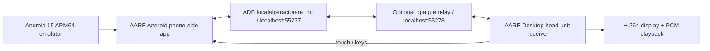
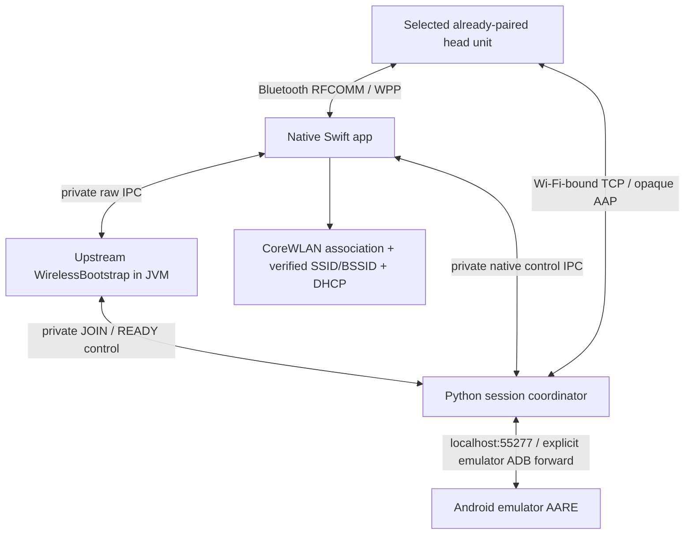

# Architecture and responsibility boundaries

## Mac local validation

The emulator runs Android and installed apps. AARE supplies the phone-side AAP implementation and draws the car-facing UI. AARE Desktop is a separate test head-unit receiver. A full-screen Maps or YouTube Android app appearing through Phone screen is mirroring, not proof that it provides a native Android Auto navigation/media template.

`stream_bridge.py` forwards opaque bytes in both directions. It does not terminate TLS, select applications, transcode video, mix audio, replace certificates or implement a new Android Auto stack. The endpoints remain responsible for all AAP/TLS behavior. ADB's host-side loopback forward is not a vehicle USB AOA implementation.

## Experimental wireless vehicle path

Stages:

1. Validate build prerequisites and avoid competing local desktop receivers. Verify the dedicated emulator name before creating its forward.
2. Start a separate native app with a new run nonce and private socket directory. The app opens only an existing paired Bluetooth target supplied by the user.
3. Discover the Android Auto RFCOMM service by SDP, or use the explicit cached-service diagnostic route. A cached channel is not a fresh service-discovery result.
4. The native app forwards RFCOMM bytes to the pinned upstream JVM `WirelessBootstrap`; WPP parsing/version/status logic remains upstream.
5. Only real received Wi-Fi credentials trigger `JOIN`. Credentials cross private IPC, are not written to logs or passed on process command lines.
6. Before even powering Wi-Fi on, the native lease journals its original state. Scan by SSID, verify security/BSSID, associate, then check actual SSID/BSSID and DHCP address/mask/router before acknowledging success.
7. The coordinator validates the endpoint lies in the associated private IPv4 subnet. It binds the car socket to the Wi-Fi address **and Darwin IP_BOUND_IF**, preserving the system's other Internet route; no global DNS/default-route rewrite is performed.
8. Establish the car TCP socket before consuming the emulator's single AAP server connection. After both sockets exist, acknowledge READY and relay raw AAP/TLS.
9. Keep the real WPP/RFCOMM link alive for the session. Cancellation, time limits or a terminated link stop the relay and trigger native Wi-Fi restoration.

The car must start its AP and provide its own WPP start/credential messages. This repository never invents those messages, creates a fake success grant or fixes a car-side controller handoff. It cannot resolve a vehicle's `aa-ap-demand-withdrawn` by merely connecting TCP.

## Code map

| Path | Responsibility |
|---|---|
| `scripts/repro.py` | Explicit dependency fetch, source preparation, JVM/desktop build, dedicated AVD creation |
| `scripts/patch_apk.py` | Hash-gated encoder callback patch and new local debug signature |
| `scripts/lab.py` | Explicit emulator-only ADB lifecycle and local relay launch |
| `bridge/native-host/RfcommBridge.swift` | Bounded raw RFCOMM/private UNIX streams |
| `bridge/wireless-session/native/main.swift` | Bluetooth delegate, app lifecycle, signal handling and bounded metadata report |
| `native/CoreWifiRadio.swift` | CoreWLAN implementation; DHCP reads via macOS ipconfig |
| `native/WifiLease.swift` | Original network snapshot, durable journal, ownership checks, restore/recovery policy |
| `native/NativeControl.swift` | Limited private control messages, serialized radio worker and exclusive radio lock |
| `java/EmulatorWirelessSession.java` | Thin adapter around the upstream WPP bootstrap |
| `session_control.py` | JOIN/READY validation and relay admission |
| `run_session.py` | Supervisor, separate child lifetimes, cancellation, journal gates and final receipt |
| `stream_bridge.py` | Bounded duplex buffers, backpressure, EOF/half-close, socket cleanup and cancellable connects |

## State, logs and limits

- Single native Wi-Fi worker; `radio.lock` prevents a second process from changing radios while the first may still be restoring.
- Coordinator lock prevents competing live launches from this checkout. A stale recovery journal blocks a new projection attempt.
- IPC directories are user-owned0700. Journal is0600 and password-free; it is written before mutation and fsynced with its parent directory.
- IPC lines max8192bytes. Relay max262144bytes per pending direction, fixed-size reads and backpressure.
- Native report retains the most recent128events. It records frame lengths/status, not WPP payloads or credentials.
- Default live session300seconds, allowed10–600seconds. Relay idle timeout30seconds; TCP connect timeout5seconds per endpoint; native cleanup receipt wait30seconds.
- CoreWLAN calls are system calls that may block beyond the user-space deadline. The supervisor reports incomplete restoration and retains obligations rather than claiming timeout implies completion.
- Per-run directories are not automatically pruned. Audio diagnostic stats overwrite a small JSON; PCM capture is off unless deliberately enabled. Optional PCM capture is capped at4,000,000bytes per stream/connection, not a cap across unlimited runs.

The default `--check` has no ADB, network association or radio side effects. A build/test is not permission to enter the live path.

## Evidence levels

`wifi_join_verified` requires native association/DHCP checks. `tcp_pair_connected` is only socket establishment. `aap_tls_accepted` is not observed by the opaque relay. `projection_verified` stays false unless an independent, accurately described vehicle observation is recorded. Byte counts and WPP success are insufficient to promote either field.
